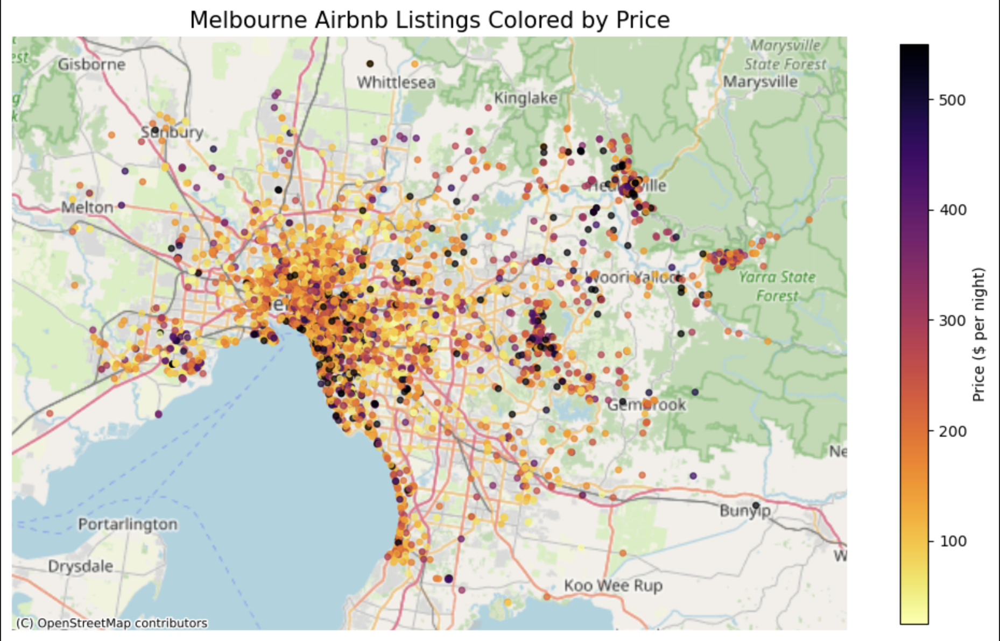

# 🏡 Predictive Analytics: Airbnb Pricing in Melbourne
### ⭐ *1st Place — BUSA8001 Predictive Analytics Competition (105 Teams)*
[](Acknowledgment_Letter.pdf)
[](https://racheltran184.github.io/Python-Project-1/)
[](#how-to-run)

**Pricing Melbourne's short stays.** A price model for 7,000 Airbnb listings that placed 1st of 105 teams in a Kaggle competition, a post-competition check of where its error came from, and what the gap between a listing's price and its fair price tells hosts, guests, platforms and policy makers.



*Every training listing, shaded by nightly price (colour scale capped at the 95th percentile). From the EDA notebook; basemap © OpenStreetMap contributors.*

---

## Overview

Hosts price by feel, guests can't tell a fair rate from an inflated one, and regulators can't see what short stays earn. The competition brief was narrower: predict the nightly price of 3,000 Melbourne listings from 7,000 that had prices, scored by mean absolute error on a hidden test set. The three notebooks are the competition work. The [case study](https://racheltran184.github.io/Python-Project-1/) adds a post-competition check of the error, a fair-price model and a hedonic regression, and turns them into actions for hosts, guests, platforms and policy makers.

| Item | Detail |
|---|---|
| **Event** | Kaggle competition for a postgraduate predictive analytics unit (Semester 1, 2025) |
| **Result** | 1st of 105 teams on the private leaderboard, as a team of three |
| **Data** | Inside Airbnb listings for Greater Melbourne, supplied by the organisers; latest review 23 March 2023; 30 councils, 61 fields per listing |
| **Metric** | Mean absolute error (MAE) in dollars per night, on a hidden half of the 3,000 test listings |
| **Stack** | Python, pandas, scikit-learn, XGBoost, LightGBM, Optuna, SHAP, GeoPandas, OSMnx, Geopy, VADER |

### Headline numbers

| Figure | What it means |
|---:|---|
| **1st / 105** | Teams on the private leaderboard |
| **$108.80** | Private-leaderboard MAE, tuned XGBoost |
| **61 → 175** | Raw columns in, model-ready features out |
| **51%** | Share of all absolute error from 10 placeholder prices above $5,000, which are 0.14% of listings |
| **23%** | Listings asking 20% or more above their fair price; they average 12.9 open nights in the next 30 days against 10.0 |

### What made the data hard

- **Skew.** Median price $172 a night, 99th percentile $1,100, maximum $145,160. One bad price can outweigh thousands of good ones.
- **Shift.** Host response time was missing for 0% of training listings but 24.6% of test listings; review scores for 0.3% against 10%. Dropping gaps would have dropped a quarter of the predictions.
- **Mess.** 2,362 distinct amenity strings, free-text descriptions, and bathrooms written as "1.5 shared baths".

---

## Model results

| Model | CV MAE | Private MAE | Public MAE | Features kept |
|---|---:|---:|---:|---:|
| **XGBoost** (1st) | $51.35 | **$108.80** | $268.17 | 111 |
| LightGBM (DART) | $51.07 | $109.68 | $267.11 | 108 |
| Random Forest | $58.34 | $118.18 | $272.70 | 107 |

*CV is 5-fold cross-validation from the notebooks (Random Forest was tuned on 3 folds and checked on 5). Private is the hidden half of the test set that set the final ranking; public is the other half.*

- **Model the log of price.** Training on log(1 + price) tames the skew, so a $20 miss on a $100 room and a $200 miss on a $1,000 house count for about the same.
- **Rank every feature first.** A LightGBM model ranks all 175 features by mean absolute SHAP value; XGBoost and Random Forest rank them by their own importance scores.
- **Let Optuna choose how many to keep.** The number of top features is a hyperparameter, searched together with depth, learning rate and regularisation by a TPE sampler: 50 trials on 5-fold cross-validation for the boosters, 30 trials on 3 folds for Random Forest.
- **Match the loss to the metric.** XGBoost was trained on absolute error (`reg:absoluteerror`), the leaderboard's yardstick. It scored 8% lower error than Random Forest on the private leaderboard and finished $0.88 ahead of LightGBM.

## Why $51 in validation became $109 on the leaderboard

Cross-validation said the models missed by about $51 a night; the private leaderboard said $109. The notebooks' first read was that tabular data can't see what guests see, such as photos. Re-checking after the competition showed most of the gap came from how the error was measured.

1. **Capped answers.** Stage 5 of the pipeline capped every training price at $1,100, the 99th percentile. Cross-validation therefore scored predictions against capped prices, while the leaderboard scored them against prices as listed.
2. **Placeholder prices.** Ten listings ask more than $5,000 a night: a two-guest apartment at $145,160, a private room at $104,983, and one titled "Test listing Do Not Book". They are 0.14% of listings but 51% of all absolute error.
3. **Small halves, big swings.** A single placeholder like the $145,160 one would add about $97 to the MAE of a 1,500-listing leaderboard half on its own. That is the likeliest reason the public (about $268) and private (about $109) scores disagreed so sharply while the ranking held.

| Same predictions, scored against | MAE |
|---|---:|
| Capped prices (what cross-validation measured) | $51.68 |
| Listed prices, minus the 10 placeholders above $5,000 | $55.94 |
| All listed prices (the leaderboard's yardstick) | $114.91 |
| *Competition: private leaderboard, XGBoost* | *$108.80* |

Listings above $1,100 a night are 1% of listings but 60% of the re-check's error. The typical miss is smaller than the mean suggests: a median of $24 per listing, with 61% of predictions within 20% of the listed price. The real luxury gap is in the $500–1,100 band, where the median prediction is $482 against a median price of $633.

*Re-check method: scikit-learn `HistGradientBoostingRegressor` (absolute-error loss, log target) on the same 175 engineered features, 5-fold cross-validation with seed 42. It reproduces the notebooks' CV MAE ($51.68 against $51.07–51.35); only the prices it is scored against change.*

---

## Six findings

*Hedonic regression: log price on size, type, location, 28 amenities and host signals; 6,990 listings, R² = 0.64, robust standard errors. Fair-price model: the engineered features minus calendar and review counts, each listing priced out of fold. A March 2023 snapshot: effects are associations, not proof of cause, and booked nights and revenue are estimates.*

**1. Location is a U, not a slope.** Against a comparable listing in the middle ring (7–15 km out), a central listing asks 17% more and an inner-ring one 11% more; the outer suburbs ask 9% less. Then prices climb again: the Yarra Ranges asks 28% more, the most of any area, and is the dearest council, at a median of $270 a night. Olinda, Brighton and Healesville top the suburbs with 40 or more listings, at medians of $319, $287 and $271.

**2. Size sets the base; bathrooms refine it.** Property type, guest capacity, bedrooms and bathrooms are the model's four most influential features. An extra bedroom adds 18% and an extra bathroom 14% to an otherwise comparable listing, while a shared bathroom costs 27% and a private room 31% against the entire home.

**3. Some amenities pay; many don't move the price.** A fireplace (+18%), allowing pets (+14%) and a clothes dryer (+11%) lead the premiums: about $31, $23 and $18 at the median price of $172 a night. Air conditioning adds 8% and is missing from 15% of listings. Pools, balconies, workspaces and views show no clear premium once size and location are held equal.

**4. Trust fills the calendar; it doesn't raise the price.** Superhosts, 43% of listings, charge 5.5% less than comparable listings, yet log 22 reviews a year against 7 and rate 4.89 against 4.70. A rating of 4.9 or above does carry a 13% premium, and instant-book listings charge 15% more than comparable request-to-book ones.

**5. Overpricing shows up as empty nights.** 23% of listings ask 20% or more above their fair price. They average 12.9 open nights in the next 30 days against 10.0 for fairly priced listings, and an estimated 26% fewer booked nights a year (89 against 121), so their median yearly revenue is no higher: $17.6K against $17.1K. At the other end, 235 listings are booked solid yet sit a median 29%, or $44 a night, below fair price: up to about $7,800 a year each if demand holds. New listings with fewer than three reviews ask 22% more than comparable listings.

**6. A professional market with a regional engine.** 61% of listings belong to hosts with more than one listing, and 21% to operators with ten or more. An estimated 1,796 entire homes, a third of entire-home listings, were booked 180 or more nights in the year, led by the City of Melbourne (738), the Yarra Ranges (215) and Port Phillip (203). Across all 10,000 listings, bookings come to an estimated $206M a year over about one million nights; among the 7,000 priced listings, the Yarra Ranges holds 9% of listings but earns 15% of booking revenue.

*Booked nights follow Inside Airbnb's occupancy model: reviews in the last 12 months ÷ a 50% review rate × 3-night stays (or the minimum stay if longer), capped at 70% of the year. Revenue = booked nights × nightly price (capped at $40 to $1,100), excluding cleaning fees.*

---

## Actions: the next 0–6 months

| Who | Action | Why | Track |
|---|---|---|---|
| Hosts | Price inside the fair band: within 20% of comparable listings (same size, type and council) | Listings 20%+ above fair price average 12.9 open nights in the next 30 days against 10.0 | Open nights in the next 30 days |
| Hosts | Raise the rate 5–10% when the next month is full | 235 booked-solid listings sit a median $44 a night under fair price | Revenue per available night |
| Hosts | Upgrade what guests pay for: air conditioning, a dryer, a dishwasher, pets allowed | +8%, +11%, +4% and +14% for comparable listings; a pool, balcony or workspace shows no clear premium | Payback = cost ÷ (premium × booked nights) |
| Hosts | Launch at fair price, then climb | New listings ask 22% more and average 12.8 open nights against 9.8; a 4.9+ rating later earns +13% | Days to the first three reviews |
| Guests | Benchmark before you book | 23% of listings ask 20%+ above fair price; 18% sit 20%+ below it | Price against comparable listings |
| Guests | Start with superhosts | 5.5% cheaper than comparable listings, rated 4.89 against 4.70 | Rating per dollar |
| Guests | Stay one ring out, 7–15 km from the CBD near a train or tram line | About 15% cheaper than the central ring and 10% cheaper than the inner ring | Total trip cost, fares included |
| Guests | Book on request when dates allow | Instant-book listings charge about 15% more | Saving per night |
| Platforms | Catch placeholder prices at entry: flag prices above 5× the fair estimate | 10 listings above $5,000 are 0.14% of listings but 51% of model error | Flags resolved within 7 days |
| Platforms | Show hosts a fair-price band, and make it the default for new listings | A third of listings with fewer than three reviews sit 20%+ above fair price | Share of listings within 20% of fair price |
| Platforms | Badge well-rated listings priced at or below fair value | Superhost listings are already cheaper and better rated | Conversion of badged listings |
| Platforms | Record whether each unavailable night is booked or blocked | Occupancy, revenue and any levy base have to be estimated from reviews today | Share of nights with a known status |
| Policy makers | Count homes, not listings: entire homes booked 180+ nights, by council, every quarter | 1,796 entire homes cross that line; City of Melbourne 738, Yarra Ranges 215, Port Phillip 203 | Entire homes booked 180+ nights |
| Policy makers | Benchmark the levy against a model-based revenue estimate for each council | 7.5% of the sample's estimated $155M of bookings is about $11.6M a year (about $15M across all 10,000 listings); the State Revenue Office reported $19.1M statewide in the levy's first six months | Collected ÷ modelled, by council |
| Policy makers | Treat hills and high-rises differently | The Yarra Ranges earns 15% of revenue from 9% of listings, and 9% of its listings belong to operators with 10+ listings, against 39% in the City of Melbourne | Entire homes held by 10+ listing operators |
| Policy makers | Use the 28-night line for renters | Only 2.3% of listings require 28+ nights; such stays fall outside the levy and price about 10% below comparable short stays | Listings with 28+ night minimums |

Victoria's 7.5% short stay levy has applied to stays under 28 days since 1 January 2025, and owners corporations can now ban short stays by a 75% vote. This snapshot predates both, so it doubles as a pre-levy baseline. Levy facts: State Revenue Office Victoria, [short stay levy](https://sro.vic.gov.au/owning-property/short-stay-levy/understanding-short-stay-levy) and its 2024–25 annual review.

## Long-term strategy: 1–3 years

| Track | Now (0–6 months) | Next (6–18 months) | Later (18–36 months) |
|---|---|---|---|
| **Run the business** (hosts, property managers, platforms) | A fair-price engine: run the model weekly over every listing, with a fair band, a flag for gaps above 20% and a placeholder check at entry | Price the calendar: nightly calendars, seasons and events (Australian Open, Grand Prix, AFL Grand Final, Melbourne Cup), plus photo features to close the luxury gap ($482 predicted against $633 listed) | Manage revenue, not price: A/B-tested recommendations, monthly retraining with drift alerts, and add-or-exit decisions from modelled yield |
| **Grow the visitor economy** (state government, councils, tourism bodies) | One shared dashboard: a quarterly council view of listings, homes booked 180+ nights, modelled bookings and levy collected, with this March 2023 snapshot as the baseline | Spread visitors beyond the CBD: package hills-and-valley stays with events and transport, and spend levy revenue where visitor demand and local housing pressure meet | Balance homes and tourism: set rules council by council, and test each change against councils that didn't change (difference-in-differences) |

**Business scorecard:** share of listings within 20% of fair price · revenue per available night · placeholder prices caught before going live.
**Economy scorecard:** entire homes booked 180+ nights, by council · share of booking revenue earned outside the central ring · levy collected against the modelled estimate.

---

## How it's built

**Task 1, EDA.** Variable types, missing values in train against test, distributions and the price map above.

**Task 2, a five-stage pipeline.** Each stage owns its own columns, and every statistic is learned on the training listings only, then applied unchanged to the test listings.

```python
def preprocess_pipeline(train_df, test_df):          # simplified from Task 2
    train_df = step_1_cleaning(train_df)             # formats, amenities, suburb & council
    test_df  = step_1_cleaning(test_df)
    train_df, test_df = stage_2_imputation(train_df, test_df)
    # ↑ statistics learned on train, applied to both
    train_df, test_df = stage_3_encoding(train_df, test_df)
    train_df, test_df = stage_4_engineering(train_df, test_df)
    train_df, test_df = stage_5_transformation(train_df, test_df)
    return train_df, test_df                         # saved as 7,000 × 177 and 3,000 × 176
```

| Stage | What it does |
|---|---|
| 1. Clean | Price and rate strings to numbers; bathroom text to a count plus a shared or private flag; each coordinate reverse-geocoded to suburb and council (Geopy), cached as a lookup table |
| 2. Impute | Room and property type inferred from description text; skew-aware mean or median, and modes, learned on train only; property type → its most common room type as a fallback |
| 3. Encode | Smoothed target encoding for property type and council, on price tiers; ordinal host response time; top-10 amenity flags; one-hot bath type and host location, aligned to train columns |
| 4. Engineer | Haversine distance to the CBD and four distance zones; transit stops within 500 m (OpenStreetMap and a BallTree); VADER sentiment, 31 luxury keywords, amenity-richness ratios |
| 5. Cap | 1st and 99th percentile caps learned on train, applied identically to train and test |

**Leakage rules the pipeline enforces:** imputation values come from training listings only; target encoders are fitted on training price tiers only; amenity vocabulary and council density are learned on train and mapped to test; outlier caps come from training quantiles; one-hot test columns are re-aligned to the training schema.

**Task 3, modelling.** Random Forest, LightGBM (DART) and XGBoost on log(1 + price), each tuned with Optuna on ranked features, as described under [Model results](#model-results).

## What carries over

- **Check the yardstick before blaming the model.** The jump from $51 to $109 was mostly capped answers and placeholder prices, not missing photos.
- **Engineering beats algorithms.** On the same features, XGBoost and LightGBM finished $0.88 apart. The pipeline did the heavy lifting.
- **Prediction and explanation are different jobs.** XGBoost won the leaderboard; a regression tells a host what a dryer is worth. A good analysis uses both.
- **Label every estimate.** Occupancy, revenue and levy figures come from models, and each one says so.

**What I'd change next time:** fit target encoders inside each cross-validation fold, and score validation on raw prices with a placeholder rule; add listing photos, calendar dates and events, and try CatBoost and a stacked ensemble; refresh with post-levy data from 2025–26 to measure what the levy changed; test causal claims properly, since a snapshot can't show that adding a dryer raises the price.

## Repository

| File | What it is |
|---|---|
| `Task 1: EDA.ipynb` | Problem statement, variable types, missing values, distributions and the price map |
| `Task 2: Data Engineering.ipynb` | Five-stage preprocessing pipeline; writes `train_cleaned.csv` and `test_cleaned.csv` |
| `Task 3: Data Modeling.ipynb` | SHAP ranking, Optuna tuning and the three models; writes the Kaggle submission files |
| `train.csv`, `test.csv` | Competition data: 7,000 priced listings (61 fields) and 3,000 to predict |
| `suburb_municipality_lookup.csv` | Cached reverse-geocoding of all 10,000 listings to suburb and council |
| `train_cleaned.csv`, `test_cleaned.csv` | Pipeline output: 7,000 × 177 and 3,000 × 176 |
| `prediction_xgb.csv`, `predictions_lgbm_shap.csv`, `randomforest_submission.csv` | Submissions for XGBoost, LightGBM and Random Forest, 3,000 rows each |
| `Melbourn_airbnb_price.png` | Price map from the EDA notebook |
| `index.html` | Case study page, served at [racheltran184.github.io/Python-Project-1](https://racheltran184.github.io/Python-Project-1/) |
| `LICENSE` | Apache License 2.0 |

## How to run

1. Install Python 3.13 with `pandas`, `numpy`, `scikit-learn`, `xgboost`, `lightgbm`, `optuna`, `shap`, `matplotlib`, `seaborn`, `geopandas`, `contextily`, `osmnx`, `geopy`, `shapely`, `category_encoders`, `vaderSentiment` and `tqdm`.
2. Run **Task 1** for the EDA and the price map (the basemap tiles need internet access).
3. Run **Task 2** to rebuild `train_cleaned.csv` and `test_cleaned.csv`. It reads the cached `suburb_municipality_lookup.csv` instead of geocoding again, and downloads transit stops from OpenStreetMap through OSMnx, so it also needs internet access.
4. Run **Task 3** to tune the three models and write the submission files. Tuning runs 50 Optuna trials for each booster and 30 for Random Forest, each scored by cross-validation.

The post-competition figures (re-check, regression, fair price, booked nights and revenue) are described on the case study page; these notebooks don't produce them.

## Data and privacy

Listing data from [Inside Airbnb](https://insideairbnb.com/) for Greater Melbourne, supplied by the competition organisers: a snapshot with reviews up to 23 March 2023. A student project built as a team of three for a postgraduate predictive analytics unit; not affiliated with or endorsed by Airbnb. Post-competition figures are the author's estimates, and the recommendations are illustrative: price effects are associations, not proof of cause.

---

**Rachel Tran** · [Portfolio](https://racheltran.vercel.app) · [LinkedIn](https://www.linkedin.com/in/racheltran184/) · [GitHub](https://github.com/racheltran184)
